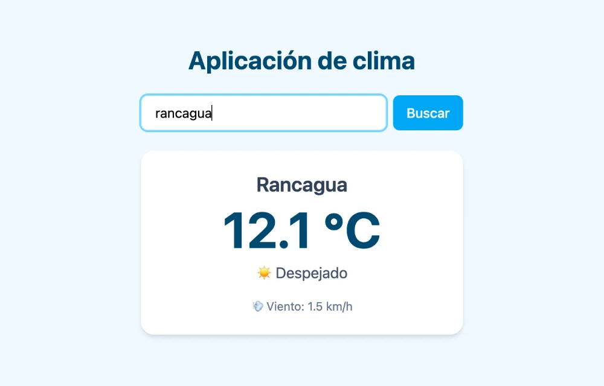

# 🌤️ App del clima

Aplicación web que muestra el clima actual de cualquier ciudad del mundo. Escribes el nombre de una ciudad y la app consulta dos APIs de Open-Meteo: primero obtiene su ubicación y después su clima.

**👉 Pruébala aquí: [clima-mario-vercel-app.vercel.app](https://clima-mario-vercel-app.vercel.app/)**



## ✨ Funcionalidades

- 🔍 Buscar el clima de **cualquier ciudad del mundo**.
- ⌨️ Buscar con **Enter** o con el botón.
- 🌡️ Muestra **temperatura**, **velocidad del viento** y una **descripción del clima** con emoji (☀️ Despejado, 🌧️ Lluvia…).
- ⏳ Mensaje de **"Cargando..."** mientras espera la respuesta.
- ⚠️ Mensajes de error claros: **"Ciudad no encontrada"** y **"No se pudo conectar. Revisa tu internet"**.
- 🚫 El botón se **desactiva** si el buscador está vacío o solo tiene espacios.
- 📱 Diseño adaptable a **celular y computador**.

## 🛠️ Tecnologías

- **React** (con hooks: `useState` y `useEffect`)
- **JavaScript** (`async/await`, `fetch`, `try/catch/finally`)
- **Vite**
- **Tailwind CSS**
- **API de Open-Meteo** (geocodificación + pronóstico), gratuita y sin API key
- **Vercel** (deploy automático con cada `git push`)

## ⚙️ Cómo funciona

```
El usuario escribe una ciudad
        ↓
obtenerLocalizacion(ciudad)  →  API de geocodificación  →  latitud y longitud
        ↓
obtenerClima({ latitud, longitud })  →  API del clima  →  temperatura, viento y código del clima
        ↓
TarjetaClima muestra el resultado
```

La app está dividida en tres componentes:

| Componente | Qué hace |
|---|---|
| `App` | Guarda el estado (`clima`, `cargando`, `error`, `ciudad`) y hace las consultas a las APIs |
| `Buscador` | El formulario con el input y el botón |
| `TarjetaClima` | Muestra el clima de la ciudad buscada |

## 💡 Lo que aprendí

- **Encadenar dos APIs:** la API del clima no entiende nombres de ciudades, solo coordenadas. Por eso primero se consulta una API de ubicación y, con su respuesta, la del clima. Usé `async/await` para esperar la primera respuesta antes de hacer la segunda consulta.
- **Manejar errores:** con `try / catch / finally` y un `throw` propio para cuando la ciudad no existe. Esto también resolvió un bug: si la consulta fallaba, la app se quedaba en "Cargando..." para siempre.
- **Separar responsabilidades:** dividí la lógica en funciones con parámetros y `return` (una para la ubicación y otra para el clima), y la interfaz en componentes que se comunican con props.
- **Formularios en React:** buscar con Enter usando `<form onSubmit>` y `e.preventDefault()`, y validar el input con `.trim()`.

## 🚀 Cómo correrlo en tu computador

```bash
git clone https://github.com/mariodinamarcap/clima.git
cd clima
npm install
npm run dev
```

Después abre `http://localhost:5173` en el navegador.

## 👤 Autor

**Mario Dinamarca** — [GitHub](https://github.com/mariodinamarcap)
